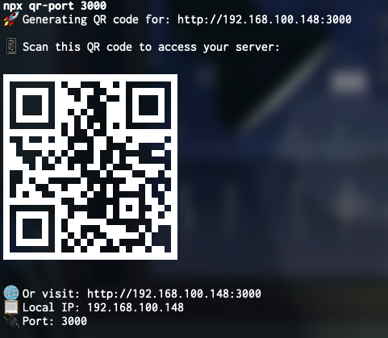

# qr-port

[](https://www.npmjs.com/package/qr-port)
[](https://opensource.org/licenses/MIT)

Expose local ports as QR codes in your terminal for easy access from mobile devices.

## Overview

`qr-port` is a CLI tool that lets you share any local port (e.g., web server, API, dev environment) by generating a QR code in your terminal. Scan the QR code with your mobile device to instantly access the service running on your machine.

## Features

- Expose any local port as a QR code
- Scan with your phone to open the service instantly
- Picks the address a phone can actually reach, skipping Docker bridges, VPN
  tunnels and VM adapters
- Machine-readable output (`--url`, `--json`) and a bundled agent skill
- Simple CLI usage

## Output example

When you run `npx qr-port 3000`, you will see a QR code in your terminal that looks like this:



## Usage

Run directly without installing using npx:

```bash
npx qr-port
```

```bash
npx qr-port 3000
```

Or Install globally using npm:

```bash
npm install -g qr-port
```

Then run:

```bash
qr-port 3000
```

This will display a QR code in your terminal. Scan it with your mobile device to access `http://<your-local-ip>:3000`.

## Options

| Option | Effect |
| --- | --- |
| `--url` | Print just the URL, no QR code |
| `--json` | Print `{url, host, port, protocol, interface}` |
| `--list` | List every detected LAN address, best candidate first |
| `--host <address>` | Skip detection and use this address |
| `--https` | Build an `https://` URL |
| `-h, --help` | Show the help |
| `-v, --version` | Show the version |

The QR code is the default, so `qr-port 3000` behaves exactly as it always has.
Everything above is opt-in.

```bash
open $(qr-port 3000 --url)      # http://192.168.1.10:3000
qr-port 3000 --host 10.0.0.5    # when detection picks the wrong address
```

### When the URL does not load

Detection ranks the addresses it finds, but it cannot see your network topology.
Start by looking at what else was available:

```bash
qr-port --list
# en0     192.168.1.10
# docker0 172.17.0.1
```

If the first one is wrong, force another with `--host`. If every address looks
right and it still fails, the dev server is probably bound to loopback — it has
to listen on `0.0.0.0` (`vite --host`, `next dev -H 0.0.0.0`,
`HOST=0.0.0.0 npm start`). A correct URL cannot reach a server that only accepts
connections from the machine it runs on.

## Vite or Next.js Integration

For Vite or Next.js projects, you can integrate `qr-port` into your development workflow easily.

### Vite

1. Modify the dev script to your `package.json`:

   ```json
   {
     "scripts": {
       "dev": "npx qr-port 3000 & vite" // Replace with your port
     }
   }
   ```

2. Run the script:

```bash
npm run dev
```

### Next.js

1. Modify the dev script to your `package.json`:

   ```json
   {
     "scripts": {
       "dev": "npx qr-port 3000 & next dev" // Replace with your port
     }
   }
   ```

2. Run the script:

```bash
npm run dev
```

## Use with AI coding agents

An agent working on a mobile layout can screenshot a headless browser, but it
cannot check anything on a real phone. `qr-port` closes that gap: the agent gets
a URL, you open it on the device.

`--url` and `--json` are what make it usable from one. They replace the QR code —
which an agent cannot scan, and which costs around 25 lines of context — with the
data itself. Failures exit `1`, and under `--json` they arrive on stderr as
`{"error": "..."}`, so nothing has to be read as prose.

```bash
npx qr-port 3000 --json
```

### Agent skill

Flags only help an agent that knows they exist. This package ships a skill in the
[Agent Skills](https://agentskills.io) format, which Claude Code, Cursor, Codex,
Copilot and around 40 other clients read:

```bash
npx skills add francogabriel92/qr-port
```

It tells the agent to prefer `--url` over the QR code, to stay on the LAN instead
of reaching for a tunnelling service, and how to diagnose a URL that does not
load. The source lives in [`skills/qr-port/SKILL.md`](skills/qr-port/SKILL.md)
and ships inside the npm package, so it never documents flags the installed
version does not have.

## Programmatic API

The address detection is exported too, in case you want the URL without the QR
code — for example to print it from your own dev script:

```js
import { resolveLanUrl, listLanAddresses } from "qr-port";

resolveLanUrl({ port: 5173 });
// { url: 'http://192.168.1.10:5173', host: '192.168.1.10', port: 5173,
//   protocol: 'http', interface: 'en0' }

listLanAddresses();
// [{ interface: 'en0', address: '192.168.1.10' }, ...] — best candidate first
```

`resolveLanUrl` throws if the port is outside 1-65535, or if the machine has no
LAN address at all. `listLanAddresses` returns every usable IPv4 address it
found, ordered by how likely it is to be reachable from a phone: virtual
interfaces (Docker, VPNs, VMs) rank last, and link-local addresses are excluded.

## Requirements

- Node.js >= 18
- Terminal with QR code display support

## License

MIT

## Contributing

Pull requests and issues are welcome!
